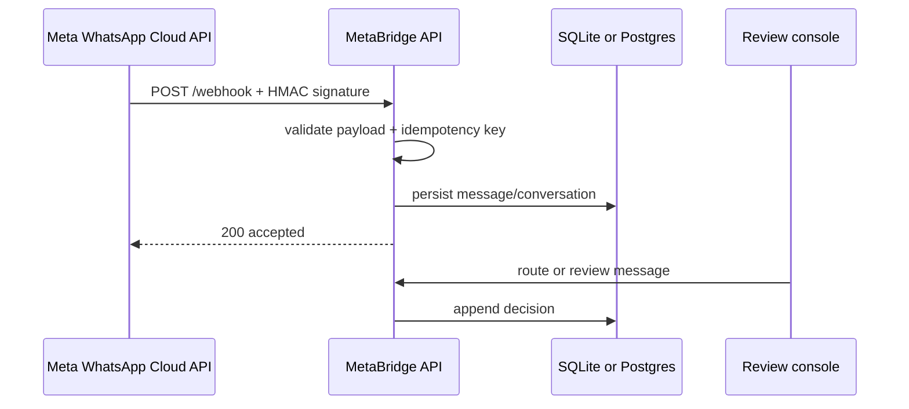

# MetaBridge

MetaBridge is a WhatsApp Cloud API inbox boundary. It turns webhook deliveries into an idempotent, reviewable workflow: verify the request, persist the message, route the conversation, and record an explicit approval decision. The implementation is provider-shaped but provider-independent at the storage and review boundaries, making it safe to run locally without a Meta account.

## Architecture



## Workflow

1. Meta sends a signed webhook event.
2. The API verifies the HMAC in production and validates the supported message envelope.
3. The provider message ID and idempotency key prevent duplicate inbox rows during retries.
4. Operators route messages to a team and priority queue.
5. Reviewers approve or reject with an auditable note.

## Structure

- `src/app.ts`: webhook, inbox, routing, and review routes.
- `src/signature.ts`: constant-time HMAC verification.
- `src/db.ts`: message, conversation, review, and idempotency tables.
- `tests/`: retry/deduplication contract test.

## Run locally

Requires Node.js 22.5 or newer because the local adapter uses the built-in `node:sqlite` module.

```bash
npm install
cp .env.example .env
npm run dev
npm test
```

## Production hardening

Use a queue between webhook acknowledgement and downstream processing, encrypt phone numbers at rest, verify Meta's app-secret proof, rotate `ADMIN_API_KEY`, add tenant filters, rate-limit operator actions, and publish outbound responses through a retryable outbox. When `DB_URL` or `SUPABASE_DB_URL` is set together with `POSTGRES_ROUTES_ENABLED=true`, the HTTP routes use an async `pg.Pool` repository and provision the `metabridge_messages`, `metabridge_conversations`, `metabridge_reviews`, and `metabridge_idempotency` tables. The local SQLite adapter remains deterministic for demos and tests.

## Security

Configure `META_APP_SECRET`, `META_VERIFY_TOKEN`, `ADMIN_API_KEY`, and `CORS_ORIGINS` in production. Webhook delivery is HMAC-checked in production; operator inbox endpoints require `X-Admin-Key` and are never anonymous.

## Production adapters

Set `DB_URL` or `SUPABASE_DB_URL` to select the managed Postgres connectivity check. The route repository is selected exclusively from these variables. If a Postgres URL is present without `POSTGRES_ROUTES_ENABLED=true`, startup fails fast instead of silently mixing persistence modes. `SUPABASE_DB_URL` uses the same async Postgres repository and the prefixed table names above. Set `STORAGE_PROVIDER=supabase` plus `SUPABASE_URL`, `SUPABASE_SERVICE_ROLE_KEY`, and `SUPABASE_STORAGE_BUCKET` (or `STORAGE_BUCKET`) for signed uploads; leave it as `local` when only Postgres route persistence is needed. The service-role key is server-only and must never be placed in the Expo client. Local tests omit these values and continue using the Node SQLite adapter.
